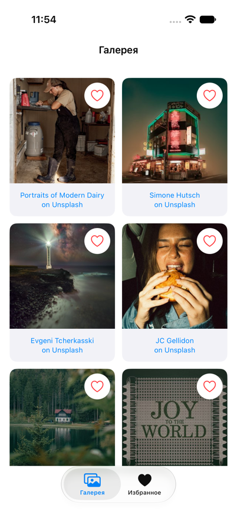
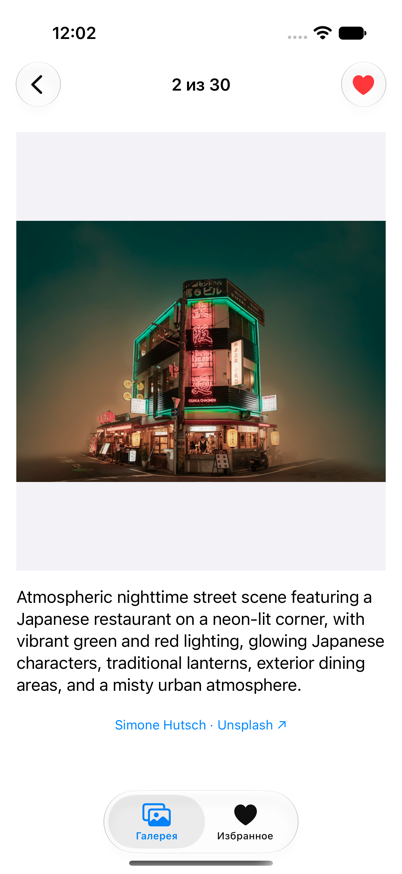
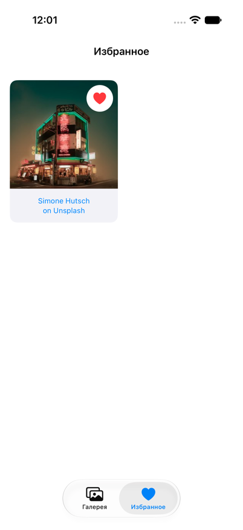

# GalleryApp

GalleryApp — приложение на Swift и UIKit для просмотра фотографий Unsplash и сохранения избранного.
iOS 17+, архитектура MVVM + Coordinator, сеть на URLSession / async-await, хранение на Core Data.
Внешних библиотек в приложении нет; SwiftLint запускается отдельно.

## Скриншоты

Снимки работающего приложения на симуляторе iPhone 17:

<p>
  
  
  
</p>

Дополнительно: [пустое избранное](Docs/Screenshots/favourites-empty.png),
[галерея в landscape](Docs/Screenshots/gallery-landscape.png),
[просмотр в landscape](Docs/Screenshots/photo-details-landscape.png).

## Запуск

1. Откройте `GalleryApp.xcodeproj` в Xcode с установленным iOS Simulator.
2. Выберите схему `GalleryApp` и симулятор iPhone.
3. Настройте локальный Access Key по [инструкции Unsplash](Docs/Unsplash-setup.md).
4. Нажмите **⌘R**. При наличии ключа и сети откроется первая страница из 30 фотографий.

Для запуска на своём iPhone выберите личную Team в Signing & Capabilities и устройство
с iOS 17 или новее. Установленная версия Xcode должна поддерживать версию iOS устройства.
Для запуска на симуляторе выберите установленный iOS runtime в списке устройств Xcode.

Без ключа проект собирается и показывает сообщение о настройке с кнопкой повтора.
Локальные фотографии этапа 2 сохранены для тестов, но больше не подменяют ответ API;
[авторы и ссылки на оригиналы](Docs/Local-photos.md).

## Как устроен экран

- `Photo` — модель ответа API: id, необязательное описание, URL изображений и автор.
- `UnsplashPhotoService` — `GET /photos?page=…&per_page=30` через URLSession и async/await. Проверяет HTTP-ответ и декодирует JSON.
- `GalleryViewModel` — список, загрузка, ошибки, повтор и номер следующей страницы. Не импортирует UIKit; сервис передаётся через протокол.
- `ViewController` — часть View в MVVM: создаёт UICollectionView и передаёт данные ViewModel ячейкам.
- `PhotoCell` — UIImageView, индикатор, повтор загрузки изображения и ссылка на автора. Отменяет старую задачу и проверяет id перед показом ответа.
- `ImageLoader` — общий загрузчик с NSCache и URLCache; одновременные запросы одного URL используют одну загрузку.
- `AppCoordinator` — создаёт зависимости, открывает просмотр выбранного фото и ссылки на авторов.
- `PhotoDetailsViewModel` — хранит снимок загруженного списка и индекс выбранного фото, проверяет границы списка.
- `PhotoDetailsViewController` — управляет UIPageViewController; каждая страница PhotoPageViewController показывает изображение, описание и ссылку автора.
- `SceneDelegate` — создаёт UIWindow для конкретной сцены и удерживает Coordinator.
- `FavouritesRepository` — чтение и запись Core Data; реализует протокол FavouritesPersisting для подмены в тестах.
- `FavouritesStore` — единое состояние избранного, ошибки и уведомления ViewModel после сохранения.
- `FavouritesViewModel` — данные вкладки избранного. Вместе с GalleryViewModel реализует PhotoGridViewModel: один UIKit-экран сетки работает с двумя разными источниками данных.

Коллекция и изображение размещены кодом через Auto Layout. Раскладка ячеек задаётся
UICollectionViewCompositionalLayout: квадратные изображения с подписями авторов, отступы 16 pt по краям
и 12 pt между ячейками. Число колонок рассчитывается по доступной ширине контейнера,
а не по размеру физического экрана, и обновляется при повороте.

Исходные AppDelegate, Main.storyboard и LaunchScreen сохранены. Main.storyboard
больше не запускается: удалены `UISceneStoryboardFile` из конфигурации сцены и
`INFOPLIST_KEY_UIMainStoryboardFile` из настроек target. LaunchScreen остаётся экраном запуска.

## Проверка галереи вручную

1. Настройте ключ и запустите приложение с интернетом.
2. Прокрутите к концу: следующая страница добавится без удаления существующих фото.
3. Отключите сеть перед следующей страницей; после восстановления сети нажмите «Повторить».
4. Потяните сетку вниз для обновления первой страницы.
5. Быстро прокрутите и поверните устройство: фото не должны подменяться ответами для старых ячеек.
6. Проверьте ссылку автора и повтор отдельного изображения при ошибке его загрузки.
7. Нажмите на само фото: откроется просмотр внутри приложения с номером «N из M».
8. Проведите влево и вправо: меняются фото и номер. На границах списка перелистывание останавливается.
9. Поверните устройство и проверьте описание; длинный текст можно прокрутить вертикально.
10. Вернитесь кнопкой назад: галерея сохраняет позицию. Ссылка автора отдельно открывает браузер.

Просмотр использует список, загруженный на момент открытия. Новые страницы подгружаются
при прокрутке галереи. Если description отсутствует, используется alt_description,
а если нет обоих — «Без описания».

## Избранное

Вкладки «Галерея» и «Избранное» имеют собственные UINavigationController.
Сердечко в сетке и просмотре добавляет или удаляет фото. Все экраны используют один
FavouritesStore; состояние обновляется после успешного сохранения. Пока идёт чтение
или запись, сердечки отключены. Ошибка показывается с возможностью повтора;
неудачная запись не меняет отображаемое избранное.

Core Data использует SQLite в Application Support приложения. Схема задана кодом:
сущность Favourite содержит уникальный id, addedAt и payload (JSON метаданных Photo).
Это простая схема для списка без поиска по автору/описанию; для таких запросов стоило бы
выделить соответствующие поля в отдельные атрибуты. Картинки в базу не записываются.
Метаданные доступны после перезапуска без API, но загрузка изображения может потребовать сеть.
Избранное локальное: оно не изменяет лайки в аккаунте Unsplash.

Проверка вручную:

1. Нажмите сердечко в галерее и откройте вкладку «Избранное» — там появится фото.
2. Откройте это фото и снимите сердечко; вернитесь в список и проверьте удаление.
3. Перейдите в галерею: сердечко у того же фото должно быть пустым.
4. Добавьте фото снова, остановите приложение в Xcode и запустите через ⌘R без удаления приложения.
5. Проверьте, что фото осталось в избранном; удалите его и повторите запуск.
6. Удалите последнее избранное — появится подсказка пустого состояния.

При удалении из просмотра открытый снимок списка сохраняется для стабильного перелистывания;
сердечко обновляется сразу, а после возврата удалённого фото в избранном уже нет.

## Пагинация и кеш

Флаг загрузки устанавливается до первого await, поэтому повторные события прокрутки
не создают параллельных запросов страницы. Номер страницы увеличивается только после
успеха; повтор запрашивает ту же страницу. Дубликаты удаляются по id. Конец ленты
определяется по Link rel="next" (без заголовка — по размеру ответа); пустая страница завершает загрузку.
Ошибка обновления сохраняет старые фото, повтор снова запрашивает первую страницу.

NSCache хранит подготовленные изображения с лимитом стоимости 48 МБ. URLCache использует
16 МБ памяти и 100 МБ диска с учётом HTTP-заголовков. Миниатюры подготавливаются асинхронно
в размере до 600 × 600. Просмотр использует regular URL и отдельный общий для его страниц
загрузчик с размером до 1600 × 1600 и такими же лимитами кеша.
Запросы изображений используют URL из API без удаления параметров.
Отмена задачи ячейки не прерывает общую загрузку, нужную другим ячейкам; результат остаётся в кеше.
Лента галереи не сохраняется между запусками; метаданные избранного сохраняются отдельно.
HTTP-кеш не является полноценным офлайн-режимом.

## Тесты

В Xcode нажмите **⌘U** для запуска всего набора: **22 unit-теста Swift Testing и 1 UI-тест**.
Либо выберите отдельный набор в Test Navigator: `GalleryAppTests`, `GalleryPaginationTests`,
`PhotoServiceTests`, `GalleryRenderingTests`, `PhotoDetailsTests`, `FavouritesTests`, `FavouritesPersistenceTests`.
Тесты Swift Testing проверяют конкурирующие запросы, повтор страницы, обновление,
дубликаты, пустой ответ, отсутствие описания, параметры HTTP-запроса, лимит запросов,
отсутствующий ключ и общий кеш изображений. Они используют подменные сервисы/URLProtocol,
не требуют Access Key и не расходуют квоту Unsplash. Дополнительно проверяются создание
первой ячейки, передача выбранного фото без открытия внешней ссылки и границы просмотра.
Тесты избранного проверяют синхронизацию ViewModel, ошибки чтения/записи и повтор,
защиту от одновременных записей. Отдельный тест создаёт временную SQLite-базу и проверяет
повторное открытие, отсутствие дубликатов и сохранение удаления.
Дополнительно проверены отмена запроса, некорректный JSON, HTTP 401, пустой ответ с Link next
и резервное описание при пустой строке. UI-тест проверяет переходы между вкладками,
не зависит от содержимого сети и не изменяет избранное. Сам запуск приложения в UI-тесте
может запросить первую страницу, если локально настроен ключ.

Для подготовки к защите: [разбор архитектуры простыми словами](Docs/Architecture-walkthrough.md).

## Проверка стиля

Установите [SwiftLint](https://github.com/realm/SwiftLint#installation):

```sh
brew install swiftlint
```

Из корня репозитория выполните:

```sh
sh Scripts/lint.sh
```

SwiftLint проверяет приложение и оба тестовых target. Команда завершается ошибкой
при новых замечаниях. Проверка запускается отдельно от сборки Xcode.
Проверено со SwiftLint 0.65.1. Если утилита не находит SourceKit из-за выбора другой
версии Xcode, укажите путь явно: `DEVELOPER_DIR=/Applications/Xcode.app/Contents/Developer sh Scripts/lint.sh`.
`.swiftlint-baseline.json` фиксирует только замечания исходного шаблона, чтобы
сохранить существующий код (сейчас осталось 5 замечаний AppDelegate). Не обновляйте baseline для сокрытия новых нарушений;
по мере замены шаблонных файлов старые замечания следует устранить.

## API-ключ

Ключ хранится только в локальном `GalleryApp/Secrets.plist`, исключённом из Git.
В репозитории есть `Docs/Secrets.example.plist` без настоящего ключа.
Инструкция и ограничения хранения ключа в приложении: [Unsplash setup](Docs/Unsplash-setup.md).

## Проверка и ограничения

Результаты и ручные сценарии: [проверка перед сдачей](Docs/Verification.md).
Короткий сценарий демонстрации: [подготовка к защите](Docs/Defense.md).

- Избранное сохраняет метаданные; полный офлайн-режим изображений не заявлен.
- Просмотр листает только фотографии, загруженные к моменту открытия.
- При записи избранного остальные сердечки временно отключены; операции выполняются последовательно.
- Схема Core Data задана кодом, метаданные хранятся в JSON; поиск по полям и миграции расширенной схемы не реализованы.
- Лимиты NSCache — рекомендации для освобождаемого кеша, а не гарантия общего потребления памяти.
- Минимальная версия — iOS 17; фактические версии среды проверки указаны в Verification.md.
- API-ключ исключён из Git, но доступен внутри установленного приложения; ограничения описаны в инструкции настройки.
